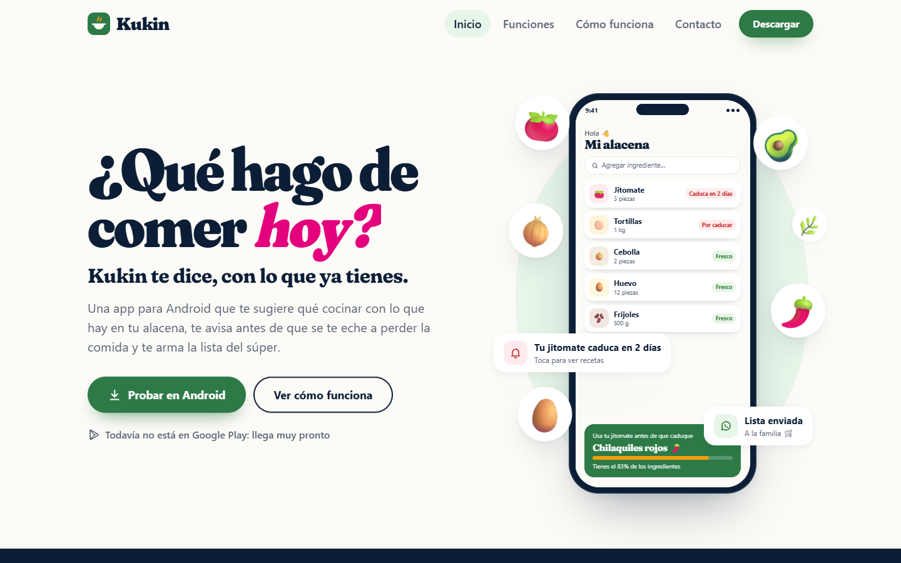
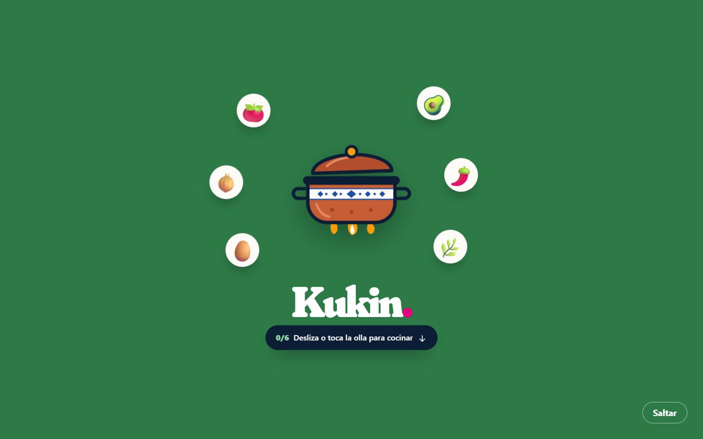
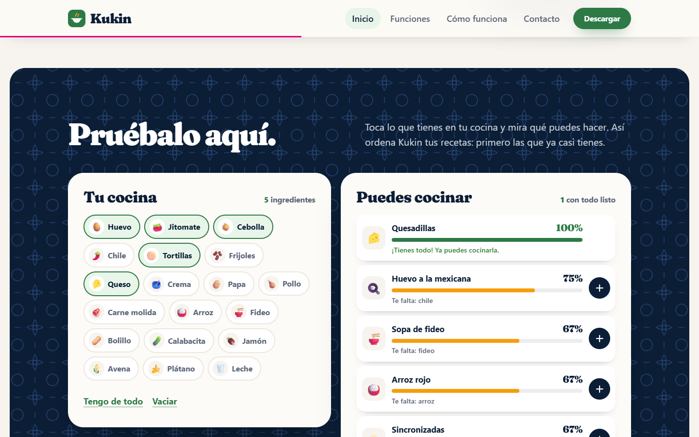
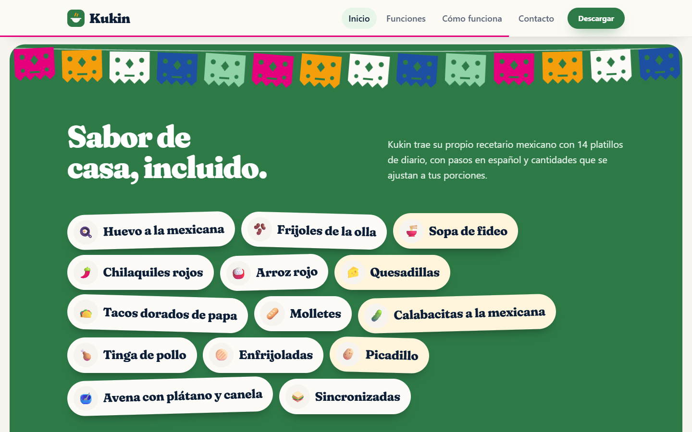
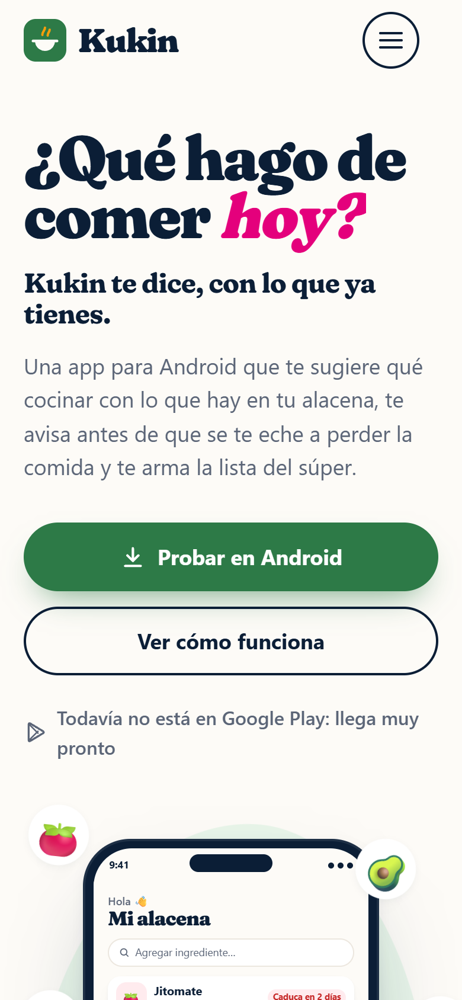

<div align="center">


# Kukin · sitio web

**¿Qué hago de comer hoy? Kukin te dice, con lo que ya tienes.**

Sitio promocional de **Kukin**, una app para Android que te sugiere qué cocinar con lo que hay en tu alacena, te avisa antes de que se te eche a perder la comida y te arma la lista del súper.

[**Ver el sitio en vivo →**](https://jesusmendozag.github.io/ProyectoFinalWeb/)


</div>

---

## Capturas

| Inicio | Pantalla de carga interactiva |
|---|---|
|  |  |
| **Demo "Pruébalo aquí"** | **Recetario mexicano** |
|  |  |

<p align="center"></p>

> Las pantallas del celular que aparecen en el sitio son **ilustraciones** de la app, hechas en HTML. Se reemplazarán por capturas reales.

---

## Qué tiene el sitio

- **5 páginas:** Inicio, Funciones, Cómo funciona, Descargar y Contacto (más una página 404).
- **Pantalla de carga interactiva:** una olla de barro hierve mientras carga la página. Al terminar, el visitante mete los 6 ingredientes con la rueda del mouse, deslizando el dedo, tocando la olla o con el teclado. Al final la olla explota y sube el telón. Se puede saltar.
- **Celular que cambia de pantalla con el scroll:** alacena → recetas → modo cocina → lista del súper.
- **Demo "Pruébalo aquí":** eliges lo que tienes en tu cocina y las recetas se reordenan en vivo según el porcentaje de ingredientes que ya tienes. Lo que falta se puede mandar a una mini lista del súper.
- **Identidad de la app con acentos mexicanos:** verde albahaca y azul marino como base, más rosa mexicano, azul talavera, olla de barro y papel picado.
- **Animaciones** con GSAP y Lenis: textos que se arman letra por letra, scroll suave, pista horizontal de funciones, botones magnéticos y transiciones entre páginas. Hay un botón en el pie para **pausarlas**.
- **Contenido real:** todo lo que dice el sitio está en la versión 1.4 de la app. No hay precios, reseñas ni funciones inventadas.
- **Accesible:** letra grande, buen contraste, botones de 44 px o más, navegación con teclado y menú móvil.

---

## Tecnologías

| Parte | Herramienta |
|---|---|
| Servidor | [Express](https://expressjs.com/) + [Helmet](https://helmetjs.github.io/) (cabeceras de seguridad) |
| Vistas | [EJS](https://ejs.co/) con plantillas parciales |
| Estilos | CSS propio, sin frameworks |
| Animaciones | [GSAP](https://gsap.com/) (ScrollTrigger y SplitText) + [Lenis](https://lenis.darkroom.engineering/), servidos desde `node_modules`, sin CDN |
| Tipografía | [Fraunces](https://fonts.google.com/specimen/Fraunces) en títulos y la fuente del sistema en el texto |
| Publicación | GitHub Pages con GitHub Actions |

---

## Cómo correrlo en tu computadora

Necesitas [Node.js](https://nodejs.org/) 18 o superior.

```bash
git clone https://github.com/jesusmendozag/ProyectoFinalWeb.git
cd ProyectoFinalWeb/KukinWeb
npm install
cp .env.example .env      # en Windows: copy .env.example .env
npm run dev               # o: npm start
```

Abre **http://localhost:3000**.

### Variables de entorno (`KukinWeb/.env`)

| Variable | Para qué sirve | Ejemplo |
|---|---|---|
| `PORT` | Puerto del servidor | `3000` |
| `APP_NAME` | Nombre que se muestra | `Kukin` |
| `APK_DOWNLOAD_URL` | Enlace del APK de prueba. Si se deja vacío, el sitio dice "Próximamente en Google Play". | `https://github.com/.../releases/latest` |
| `CONTACT_EMAIL`, `SMTP_*` | Reservadas para conectar el formulario de contacto a un correo | — |

> El archivo `.env` **nunca se sube** al repositorio (está en `.gitignore`). Usa `.env.example` como guía.

### Scripts

| Comando | Qué hace |
|---|---|
| `npm run dev` | Servidor con recarga automática (nodemon) |
| `npm start` | Servidor normal |
| `npm run build:static` | Genera la versión estática del sitio en `KukinWeb/dist` |

---

## Publicación en GitHub Pages

GitHub Pages solo sirve archivos estáticos, así que el script [`scripts/build-static.js`](KukinWeb/scripts/build-static.js) convierte el sitio a HTML. Para eso reutiliza **los mismos controladores y vistas** del servidor, así que el contenido siempre coincide.

El flujo [`.github/workflows/pages.yml`](.github/workflows/pages.yml) construye y publica el sitio automáticamente **cada vez que se hace push a `main`**.

**Activarlo (una sola vez):** en el repositorio, ve a **Settings → Pages → Build and deployment → Source** y elige **GitHub Actions**.

En la versión de GitHub Pages el **formulario de contacto aparece desactivado**, porque no hay servidor que reciba los mensajes. En la versión con Express sí funciona: por ahora imprime los mensajes en la consola del servidor.

Para probar la versión estática en tu computadora:

```bash
cd KukinWeb
BASE_PATH=/ProyectoFinalWeb/ npm run build:static
# En Git Bash para Windows antepón: MSYS_NO_PATHCONV=1
```

---

## Estructura

```
ProyectoFinalWeb/
├── KukinWeb/
│   ├── server.js                 # Servidor Express
│   ├── scripts/build-static.js   # Genera la versión para GitHub Pages
│   └── src/
│       ├── config/env.js         # Variables de entorno
│       ├── controllers/          # Contenido real de la app (funciones, recetas, FAQ…)
│       ├── routes/               # Rutas del sitio
│       ├── views/                # Páginas EJS
│       │   └── partials/         # Cabecera, menú, pie, teléfono, pantalla de carga, papel picado…
│       └── public/               # CSS, JS e imágenes
├── docs/capturas/                # Imágenes de este README
├── PRODUCT.md                    # Qué es Kukin, para quién es y qué NO afirmar
├── DESIGN.md                     # Sistema de diseño: colores, tipografía, componentes y animaciones
└── ACENTOS-MEXICANOS-APP.md      # Guía para llevar los acentos mexicanos a la app
```

---

## Sobre el proyecto

Proyecto final de la materia de **diseño de páginas web**. Presenta **Kukin**, una app desarrollada en la materia de Desarrollo de aplicaciones móviles. La app está hecha con React + Capacitor, con backend en Spring Boot + MySQL.

- **Estado de la app:** versión 1.4. Todavía no está en Google Play y por ahora es solo para Android.
- **Desarrollado por:** Jesús Mendoza Gómez · NaatLabs, Zapopan, Jalisco.
